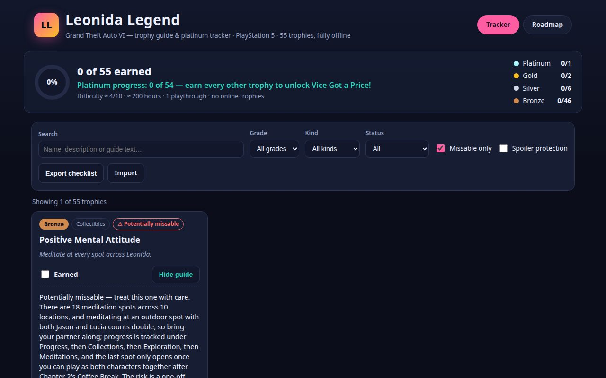
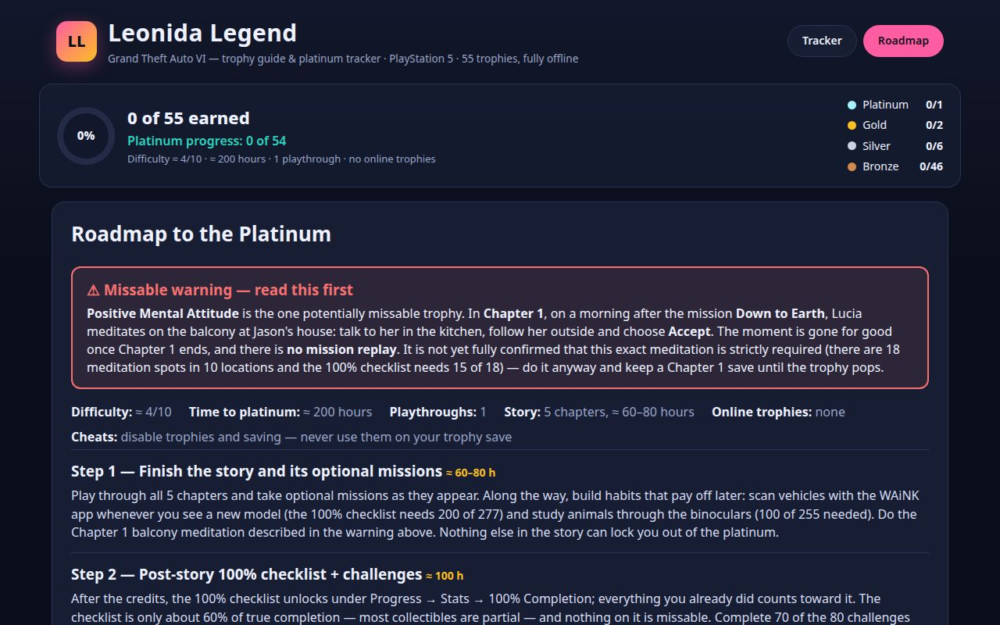
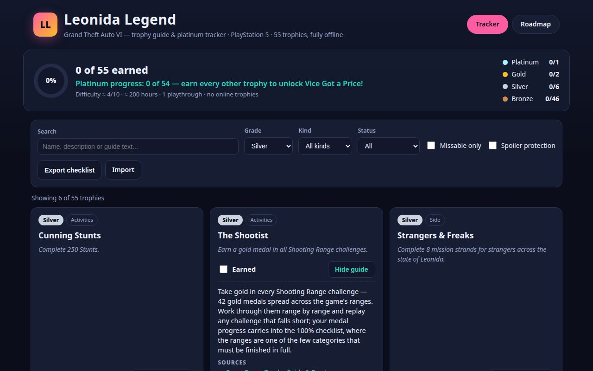
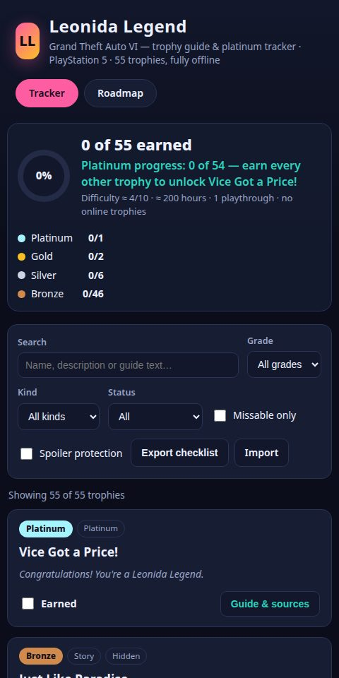

[](https://make.fun/bounty/gta6-trophy-guide-01?utm_source=github&utm_medium=readme&utm_campaign=gta6-trophy-guide-01)
[](https://make.fun/bounty/gta6-trophy-guide-01/leaderboard?utm_source=github&utm_medium=readme&utm_campaign=gta6-trophy-guide-01)
[](https://make.fun/bounty/gta6-trophy-guide-01?utm_source=github&utm_medium=readme&utm_campaign=gta6-trophy-guide-01)

# Leonida Legend — GTA VI Trophy Guide & Platinum Tracker

Leonida Legend is an offline trophy guide and platinum tracker for
Grand Theft Auto VI on PlayStation 5. It covers all 55 official trophies —
1 platinum, 2 gold, 6 silver and 46 bronze — with a written guide for every
single trophy, a step-by-step roadmap to the platinum, and clear warnings
about the one trophy you can actually miss. The whole app is a small set of
static files in `app/`; it loads nothing over the network and needs no
account, so it works just as well on a plane as at your desk.

## Features

- **Checklist tracker with saved progress** — tick trophies off as you earn
  them and your checklist is stored in the browser's localStorage, so it is
  still there when you come back.
- **Progress at a glance** — an overall percentage ring, a per-grade
  breakdown (platinum, gold, silver, bronze) and a separate platinum
  progress count (earned out of the 54 trophies that feed the platinum).
- **Search and filters** — search across names, descriptions and guide
  text, and narrow the list by grade, by kind (story, side stories,
  collectibles, activities, platinum), by status (earned / not yet earned),
  or to missable trophies only.
- **Spoiler protection** — hidden trophies stay blurred until you choose to
  reveal them, and story trophies stay masked until you have earned them,
  so browsing the list does not spoil the campaign.
- **Export and import** — back up your checklist or move it to another
  browser or device by exporting it as JSON and importing it again.
- **Roadmap view** — the `#/roadmap` view lays out the run to the platinum
  in three steps with rough hours, difficulty (about 4/10), the roughly
  200-hour total and the single-playthrough plan — and it puts the missable
  warning first, before anything else, along with advice on keeping manual
  saves because the game has no mission replay.

## Data and accuracy

Trophy names, descriptions and grades match the official PlayStation 5
list, and the full set was cross-checked against the PowerPyx trophy guide
and roadmap, the OutputLag trophy list, and the Exophase and PSNProfiles
listings — 55 out of 55 trophies accounted for.

A few honesty notes, rather than a guide that pretends to know everything:

- One trophy, **Positive Mental Attitude**, is flagged as potentially
  missable: it hinges on a short Chapter 1 moment that is gone once the
  chapter ends, so the roadmap tells you to do it and keep a Chapter 1 save.
- Five trophies have their unlock methods marked **unconfirmed at launch**
  instead of having a method invented for them; their entries say so
  plainly until the method is verified.
- Every trophy's guide cites its sources right beside the trophy, so you
  can check any claim against the listing it came from.

The underlying data lives in `app/data/trophies.json`, with one entry per
trophy carrying its name, description, grade, kind, hidden and missable
flags, whether its method is confirmed, its guide text and its sources.

## Screenshots



*Tracker with the missable-only filter on and the guide for Positive Mental Attitude — the one potentially missable trophy — expanded.*



*Roadmap to the platinum: the missable warning comes first, then the three steps with hours and difficulty, plus the manual-save advice.*



*Grade filter set to Silver (6 trophies), with The Shootist guide and its cited sources expanded.*



*The tracker at a narrow mobile width: header stats, filters and the first trophy cards.*

## How to run

Serve the app locally:

```sh
node serve.ts
```

Then open http://localhost:8080 in your browser. Alternatively, open
`app/index.html` through any static file server — there is nothing
server-side about the app itself.

To build the hand-in dossier (a copy of `app/` and `screenshots/` plus the
`dossier.json` summary) outside the grading container:

```sh
MAKEFUN_OUTPUT_DIR=out node main.ts
```

That writes the dossier into `out/`.

Everything is fully offline: no build step, no dependencies, and nothing to
install — just plain HTML, CSS, JavaScript and JSON, plus a small Node
static server for convenience.

## License

MIT — see [LICENSE](LICENSE).
